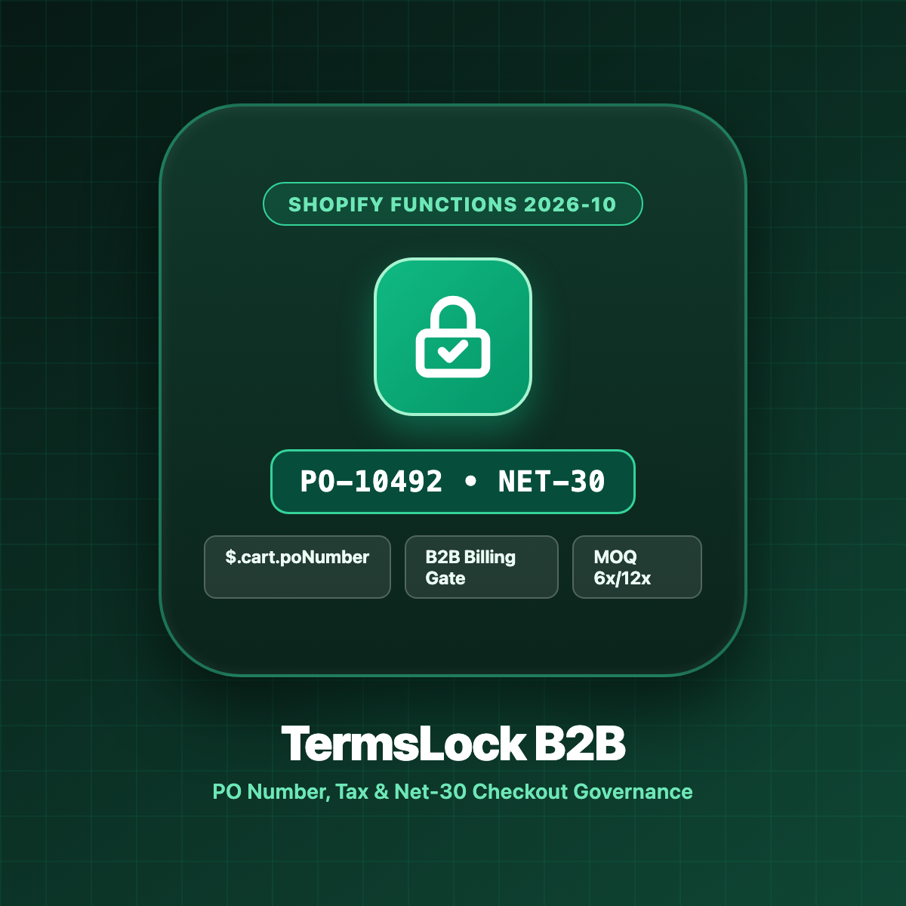
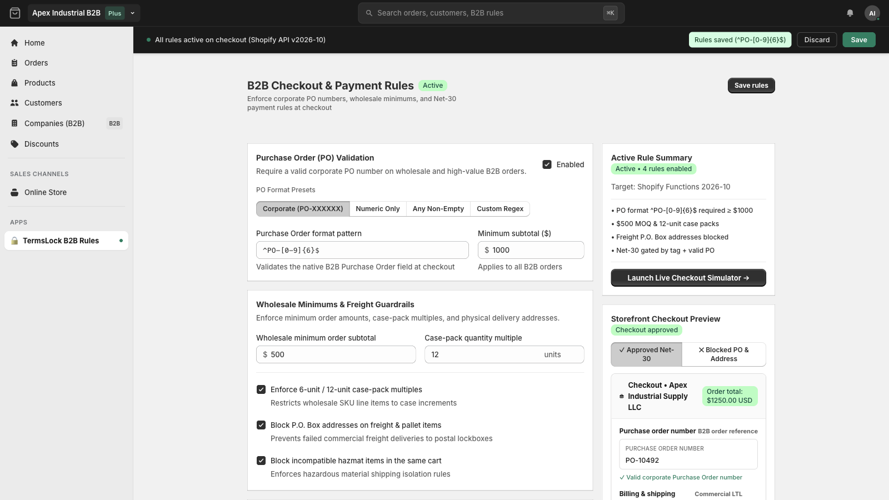
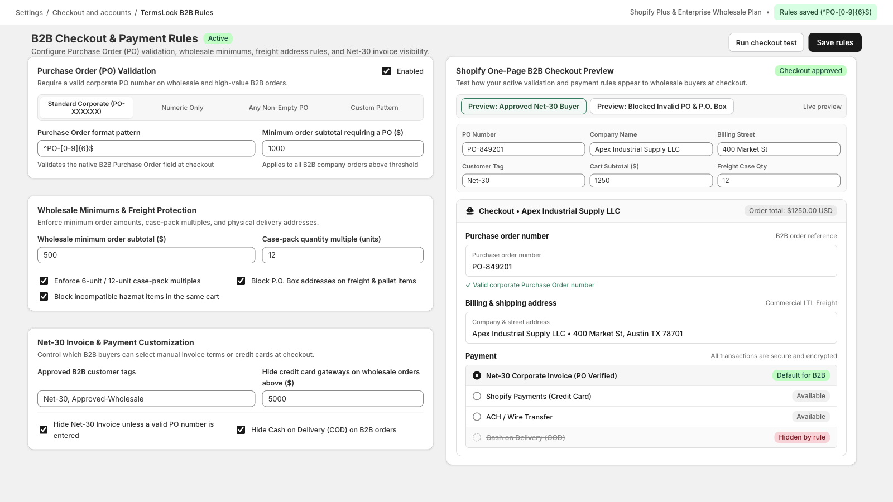
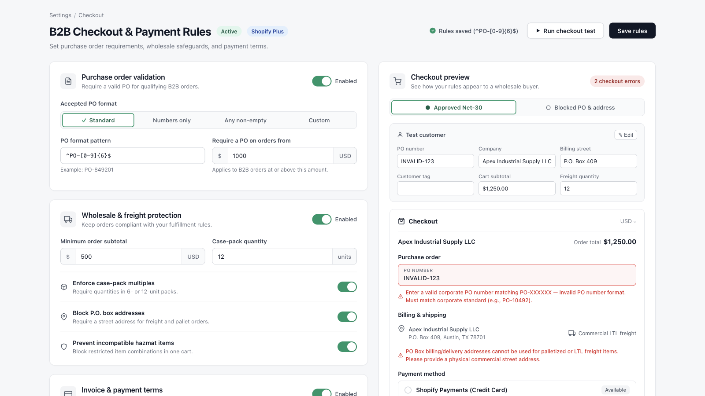

# TermsLock: B2B PO, Tax & Net-30 Checkout Rules (`com.evidencepair.shopify.termslock`)

**Target Shopify API Version:** `2026-10`
**Architecture:** 100% Native Shopify Functions (`purchase.validation.run` & `purchase.payment-customization.run`) + App-Owned Metafields (`$app:termslock`)



---

## Overview

**TermsLock** enforces deterministic B2B & wholesale checkout governance on Shopify using the native `cart.poNumber` and `cart.billingAddress` GraphQL input fields introduced in `2026-04` and stabilized in `2026-10`.

All rules execute inside Shopify's edge WebAssembly runtime in `< 1ms` with **zero external network calls**, `< 30` GraphQL query complexity points, `< 10 KB` App-Owned Metafield JSON configuration (`$app:termslock`), and `< 20 KB` Function output payloads.

---

## Key Capabilities

1. **Function #1 — B2B Cart, PO Number & Billing Address Validator (`extensions/b2b-checkout-validator`):**
   - **PO Number Format & Threshold Gate (`$.cart.poNumber`):** Require non-empty PO numbers matching your corporate regex (e.g., `^PO-[0-9]{5,10}$`) whenever `purchasingCompany` is active, buyer has tag `B2B` / `Net-30`, or cart subtotal reaches `$1,000.00+`.
   - **Freight PO Box Blocker & Tax/Company Gate (`$.cart.billingAddress.*`):** Block PO Box addresses when cart contains `Freight` or `Pallet` SKUs (`$.cart.billingAddress.address1`) and require a registered Billing Company legal name + optional VAT/EIN tax prefix (`$.cart.billingAddress.company`).
   - **Wholesale MOQ & Case-Pack Multiplier Gate (`$.cart`):** Enforce minimum B2B order subtotals (e.g., `$500.00` MOQ) and case-pack quantity multiples (`6x` or `12x` units per line item).
   - **Hazmat / Restricted SKU Combination Gate (`$.cart`):** Prevent incompatible hazardous product tags or SKU prefixes from checking out in the same order.

2. **Function #2 — Net-30 & Wholesale Payment Method Gate (`extensions/b2b-payment-gate`):**
   - **Net-30 / Invoice Locking:** Hide `Net-30`, `Invoice`, and `Manual Payment` gateways unless the buyer holds an authorized `Net-30` / `Approved-Wholesale` tag **AND** has entered a valid `cart.poNumber`.
   - **Unlocking, Renaming & Promotion:** Automatically rename (`"Net-30 Corporate Invoice (PO Verified)"`) and promote Net-30 to the `#1` payment option when verified.
   - **COD & High-Value Credit Card Shield:** Hide Cash on Delivery (`COD`) on B2B orders and hide high-fee credit card gateways when order total reaches `$5,000.00+` or customer is tagged `Wire-Only`.

3. **Embedded Admin Rule Builder & Live Dry-Run Checkout Simulator (`web/`):**
   - Built with **Shopify Polaris** design tokens and **Onest** documentation typography.
   - Compiles rules to `$app:termslock` via `cartValidationCreate`, `paymentCustomizationCreate`, and `metafieldsSet`.
   - Includes a real-time **Dry-Run Checkout Simulator** to test sample Cart Subtotals, Customer Tags (`Net-30`), PO Numbers (`PO-10492`), Billing Addresses, and Line Items before saving.

---

## Screenshots

### 1. Native `$.cart.poNumber` & `$.cart.billingAddress` Inline Validation


### 2. Net-30 Invoice & High-Value Payment Method Gate


### 3. Wholesale MOQ, Case-Pack Multipliers & Live Dry-Run Simulator


---

## Pricing Plans (Shopify Billing API `appSubscriptionCreate`)

| Plan | Price | Free Trial | Included Capabilities |
| :--- | :--- | :--- | :--- |
| **B2B Standard Plan** | `$39.00 / every 30 days` | 14 days | PO Number Regex Gate (`$.cart.poNumber`), Freight PO Box Blocker, Billing Company Gate, Wholesale MOQ & Case-Pack Multipliers (`6x`/`12x`). |
| **Shopify Plus & Enterprise Wholesale Plan** | `$99.00 / every 30 days` | 14 days | All Standard features + Net-30 & High-Value Payment Method Gate, Hazmat Incompatible SKU Matrix, Unlimited Rule Profiles, Priority Support. |

---

## Headless Build & Verification

```bash
# Typecheck all Functions, Admin modules, and tests (0 errors)
npm run typecheck

# Run the 32 deterministic Vitest unit & integration tests
npm test

# Re-generate and verify flattened 24-bit RGB App Store PNG assets
npm run build:assets
```

---

## Documentation Links

- [Merchant User Guide](docs/shopify-store/USER_GUIDE.md)
- [Privacy Policy & Mandatory GDPR Compliance](docs/shopify-store/PRIVACY_AND_GDPR.md)
- [Frequently Asked Questions (FAQ)](docs/shopify-store/FAQ.md)
- [Shopify App Store Listing Copy](docs/shopify-store/SHOPIFY_LISTING_COPY.md)
- [Shopify Functions 2026-10 PO & Billing Architecture](docs/context/01-shopify-functions-2026-10-po-billing.md)
- [Metafield `<10 KB` Compiler & Billing API Reference](docs/context/02-metafield-config-billing-api.md)
