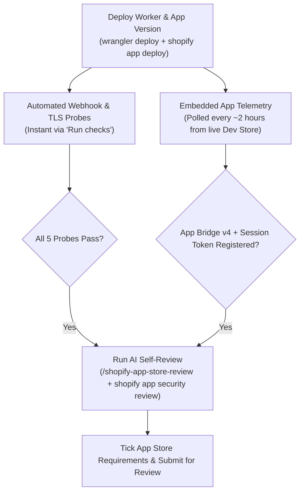

# Shopify App Store Build, Hardening & Submission Playbook (2026 Edition)

**Reference Implementation:** `TermsLock: B2B PO, Tax & Net-30 Checkout Rules` (`com.evidencepair.shopify.termslock`)  
**Target Shopify API Version:** `2026-04` / `2026-10`  
**Shopify CLI Version:** `@shopify/cli@4.9.4`  
**Deployment Target:** Cloudflare Workers (V8 Isolates) + Shopify Functions (Javy WebAssembly)

---

## Executive Summary

Building a Shopify App that compiles locally is only ~40% of the journey to a successful **Shopify App Store** submission. The remaining 60% consists of strict platform invariants, automated pre-submission validators, live Partner Dashboard telemetry gates, asset encoding constraints, and security audits that will hard-block the **"Submit for review"** button if violated.

This document distills every technical root cause, platform quirk, and verification gate encountered while taking **TermsLock** from initial architecture to a 100% green Shopify App Store submission. Use this playbook as the baseline blueprint for all future Shopify Marketplace builds.

---

## 1. Naming, URLs & Trademark Rules (Zero "Shopify" in Hostnames)

### The Trap
Shopify's App Store listing validator and `shopify.app.toml` configuration parser strictly reject any URL—including `application_url`, `redirect_urls`, `privacy_policy_url`, `demo_url`, or GitHub documentation links—that contains the substring **`shopify`** or **`example`**.

- ❌ **Rejected:** `https://termslock-shopify.evidencepair.workers.dev`
- ❌ **Rejected:** `https://github.com/Allerdyce/termslock-shopify-docs`
- ✅ **Accepted:** `https://termslock-b2b.evidencepair.workers.dev`
- ✅ **Accepted:** `https://github.com/Allerdyce/termslock-b2b-docs`

### Actionable Rules for Future Builds
1. **Never include `"shopify"` in your Cloudflare Worker name, Vercel project name, or GitHub repo name.** Use a domain-specific suffix such as `-b2b`, `-app`, or `-commerce`.
2. **Enforce a CI test on `shopify.app.toml`:** Assert via unit test that `application_url`, `redirect_urls`, and all webhook `uri` entries contain `0` occurrences of `/shopify/i` or `/example/i` (excluding standard `myshopify.com` runtime shop domains).
3. **Host `/privacy` and `/demo` directly on your production app domain:**
   - `GET /privacy` (`https://<app-domain>/privacy`) — Must render a public, zero-login HTML Privacy & GDPR Compliance Policy returning `200 OK` (`text/html`).
   - `GET /demo` (`https://<app-domain>/demo`) — Must render a public, zero-login interactive walkthrough page with an embedded screencast player.

---

## 2. Two-Surface Architecture: Dev Dashboard vs. Partner Dashboard Listing

### The Trap
In Shopify's 2026 unified developer experience, app configuration is split across two distinct surfaces that sync asynchronously:
1. **Shopify Dev Dashboard (`dev.shopify.com`)**: Controls app versions (`shopify app deploy`), extensions, TOML webhooks, access scopes, **Capabilities**, and the **App Icon**.
2. **Shopify Partner Dashboard App Store Listing (`partners.shopify.com`)**: Controls marketing copy, pricing plans (Managed Pricing), screenshots, feature banner, screencast URL, and the final **Submit for review** checklist.

### Critical Synchronization Rules
1. **App Icon Sync (The `< 100 KB` Rule):**
   - The App Store Listing page no longer has its own icon upload widget—it pulls the icon from the **Dev Dashboard**.
   - **Critical Bug Caught:** Even though the Dev Dashboard UI says *"2MB max"*, uploading a `1.19 MB` (`1200×1200`) PNG with heavy dithering noise caused the Dev Dashboard -> App Store Listing sync pipeline to silently drop the image, leaving the listing stuck on `"App icon is required"`.
   - **The Fix:** Generate clean, flat-vector `1200×1200` 24-bit RGB PNG/JPEG icons under **`50 KB`** (our final 2× supersampled emerald lock icon was **`34.6 KB`**). Once uploaded in Dev Dashboard, it synced immediately to the Partner Listing and cleared the blocker.
   - **Icon Design Rules:** Zero text on the icon (never put `"Shopify Functions"` or version numbers on the app icon), zero Shopify logos/trademarks, and `color_type = 2` (24-bit RGB, no alpha transparency channel).
2. **Capabilities Must Match Your Architecture:**
   - In the Dev Dashboard / Listing capabilities selector, only check capabilities your app actually uses (e.g., `Embedded` for an embedded Admin app). Do **not** check Checkout UI Extensions, Theme App Extensions, or POS if your app only uses headless **Shopify Functions**.
3. **App Handle Changes Upon Linking:**
   - Running `shopify app config link` creates a new `shopify.app.<slug>.toml` and assigns the canonical handle in Dev Dashboard (e.g. `termslock-b2b`). When testing on a dev store, always open `/admin/apps/<active-handle>` rather than stale handles from earlier drafts.

---

## 3. Automated Checks & Live Telemetry Gates

Shopify's submission page runs two categories of automated verification before enabling submission:



### Gate A: The 5 Instant Automated Checks ("Run checks" Button)
When you click **Run checks** on the submission page, Shopify's backend immediately probes your production `application_url` and webhook endpoints:
1. **Valid TLS/SSL Certificate:** Must return HTTPS with TLS 1.2/1.3 (Cloudflare Workers provides this out of the box).
2. **App URL Reachable:** `GET /` and `HEAD /` must return `200 OK` without crashing when no session token is present.
3. **Mandatory GDPR Webhooks Configured:** `shopify.app.toml` must declare `compliance_topics = ["customers/data_request", "customers/redact", "shop/redact"]` under `[[webhooks.subscriptions]]`.
4. **Webhook HMAC Rejection Test (401 Unauthorized):** Shopify sends a synthetic `POST` to your GDPR and `app/uninstalled` webhook endpoints with an **invalid** `X-Shopify-Hmac-Sha256` header. Your server **MUST** return `401 Unauthorized` (if it returns `200 OK` or `500`, the check fails!).
5. **Webhook HMAC Acceptance Test (200 OK):** Shopify sends a synthetic `POST` signed with your app's real `SHOPIFY_API_SECRET`.
   - **Critical Trap:** If your Cloudflare Worker has a hardcoded fallback secret (`shpss_termslock_...`) instead of the real `SHOPIFY_API_SECRET` from Dev Dashboard, the invalid HMAC test passes (`401`), but the valid HMAC test fails (`401`)!
   - **The Fix:** Immediately after linking your app (`shopify app config link`), push the real secret to Cloudflare Workers via:
     ```bash
     printf "%s" "$REAL_CLIENT_SECRET" | npx wrangler secret put SHOPIFY_API_SECRET
     ```
   - Always compute HMAC-SHA256 against the **raw, unparsed request byte buffer** (`await request.arrayBuffer()` in Workers / `Buffer.concat(chunks)` in Node.js) using constant-time comparison (`crypto.subtle.verify` or `crypto.timingSafeEqual`).

### Gate B: Embedded App Checks (App Bridge v4 & Session Tokens)
These checks verify:
- *"Using the latest App Bridge script loaded from Shopify's CDN"*
- *"Using session tokens for user authentication"*

**How to turn them green:**
1. In your HTML `<head>`, `<script src="https://cdn.shopify.com/shopifycloud/app-bridge.js"></script>` **must be the very first `<script>` tag**, preceded by `<meta name="shopify-api-key" content="<REAL_CLIENT_ID>" />`.
2. On page load inside the Shopify Admin iframe, your client bundle must call `await window.shopify.idToken()` and send an authenticated request (`Authorization: Bearer <idToken>`) to your backend (`POST /api/rules` or `GET /api/rules`).
3. **Open the app inside a real Development Store (`admin.shopify.com/store/<dev-store>/apps/<app-handle>`) and interact with it** (save a rule, run a simulation). Shopify's telemetry pipeline aggregates real embedded sessions every ~2 hours and flips both checks to green.

---

## 4. Cloudflare Workers Edge Architecture Best Practices

Running a Shopify App on **Cloudflare Workers** (`workerd`) provides `0ms` cold starts and effortless global scale, but requires strict adherence to edge runtime constraints:

| Capability | Node.js Server (`src/server.ts`) | Cloudflare Worker (`src/worker.ts`) |
| :--- | :--- | :--- |
| **Filesystem (`fs`)** | Available (`fs.readFileSync`, `fs.createReadStream`) | **Does NOT exist** at runtime |
| **CSS / JS Assets** | Can read from `dist/` or memory | Pre-compile into TypeScript string constants (`src/assets/embedded-assets.ts`) via a build script (`scripts/build-static-assets.mjs`) |
| **Large Media (`.mp4`, `.png`)** | Stream from `docs/shopify-store/` | Proxy/stream from GitHub Raw CDN (`raw.githubusercontent.com/...`) with `Range` header pass-through and cache-busting query strings (`?v=...`) |
| **Crypto / HMAC / JWT** | `node:crypto` (`createHmac`, `timingSafeEqual`) | Web Crypto API (`crypto.subtle.importKey`, `crypto.subtle.verify`) |

### Edge Caching Gotcha When Updating Store Assets
When serving `/app-icon.png`, `/screenshot-[1-3].png`, or `/demo-video.mp4` through a Cloudflare Worker proxy that fetches from `raw.githubusercontent.com`, GitHub's Fastly CDN caches raw URLs for 5–15 minutes. Whenever you regenerate an icon, screenshot, or screencast:
- Append a versioned query parameter (`?v=p13-clean`) to the upstream `raw.githubusercontent.com` URL inside `src/worker.ts` so the edge worker immediately fetches the fresh commit.

---

## 5. Shopify Functions (Wasm / Javy) Hard Invariants

When building deterministic **Shopify Functions** (`purchase.validation.run`, `purchase.payment-customization.run`, etc.) targeting API `2026-04` / `2026-10`:

1. **GraphQL Input Query Complexity (`< 30 points`):**
   - Keep `run.graphql` strictly under `30` complexity points.
   - Never fetch unbounded customer tag arrays (`customer { tags }`). Instead, use `hasAnyTag(tags: ["Net-30", "Wholesale-Approved", "Tax-Exempt"])` with a bounded array.
2. **Metafield Configuration Budget (`< 10 KB`):**
   - App-owned configuration metafields (`namespace: "$app:termslock"`) injected into `run.graphql` must serialize to `< 10,240 bytes`. Enforce this in your Metafield Compiler (`MetafieldBudgetExceededError`) before calling `metafieldsSet`.
3. **Function Output Size (`< 20 KB`):**
   - `FunctionRunResult` must serialize to `< 20,480 bytes`. Truncate and cap user-configured error messages cleanly.
4. **Zero External Network or Non-Determinism:**
   - Wasm Functions execute in an air-gapped sandbox (`11M` instruction ceiling, `5ms` CPU budget). Never call `fetch`, `Date.now()`, or `Math.random()`.
5. **Bundle Verification (`--platform=neutral`):**
   - Compile TypeScript Functions with `esbuild --bundle --platform=neutral --format=esm` and test in CI that the bundle is `< 50 KB` and contains zero Node.js globals (`process`, `Buffer`, `require`).

---

## 6. App Store Media Assets: Feature Image, Screenshots & Screencast

### 1. Feature Image vs. Screenshots (Must Be 4 Distinct Images!)
- **The Trap:** Shopify requires **1 Feature Image** (`1600×900`) plus **3+ Screenshots** (`1600×900`). If you upload Screenshot #1 as the Feature Image, Shopify's AI listing check flags a duplicate image warning (*"Two or more listing images are identical"*).
- **The Fix:** Always generate **4 distinct images**:
  1. `feature-banner-1600x900.png`: A dedicated `1600×900` hero banner showing the brand lockup and core value proposition.
  2. `01-b2b-po-number-checkout-validation.png`: State 1 (e.g., PO Number & Billing Address validation failure / inline error preview).
  3. `02-net30-payment-method-customization.png`: State 2 (e.g., Approved Net-30 payment customization & card hiding).
  4. `03-wholesale-moq-dryrun-simulator.png`: State 3 (e.g., Live Dry-Run Wasm Simulator & telemetry view).
- **Partner Dashboard Upload Quirk:** Uploading a new image on top of an existing screenshot slot in the Partner Dashboard often fails to overwrite the old image. **Always delete the old screenshot from the slot first, then upload the new PNG and click Save.**

### 2. Automated Playwright Screenshot & Screencast Hygiene
- **Wait for Interactive Hydration:** In `scripts/run_live_browser_qa.mjs`, clicking a scenario button in the UI must be followed by waiting for the DOM status badge text to actually transition (and stabilize) before calling `page.screenshot()`. Otherwise, two screenshots may capture the same initial state.
- **Lock Preview Container Heights (`min-height`):** When toggling between "Pass" and "Fail" states in a live preview panel, inline error banners increase content height. Apply `min-height: 420px; box-sizing: border-box;` on the preview card so switching states never causes layout shifts or page stretching during video recording.
- **Screencast Encoding & Smooth Scrolling (`ffmpeg`):**
  - Shopify reviewers expect a smooth, comprehensive screencast demonstrating rule configuration, scrolling down through the full page, toggling live simulation states, and inspecting the storefront checkout result.
  - Use quadratic ease-in-out scrolling (`smoothScrollTo(page, targetY, durationMs)`) in Playwright so the camera glides naturally down and back up the page.
  - Transcode Playwright's `.webm` capture into a universally playable **H.264 `.mp4`** (`-c:v libx264 -pix_fmt yuv420p -movflags +faststart`) using `ffmpeg` and serve it with `Content-Type: video/mp4` and `Accept-Ranges: bytes`.

---

## 7. Pre-Submission AI Self-Review & CLI Security Audit

As of 2026, Shopify disables the **"I've reviewed all the App Store Requirements"** checkbox until **"Run AI self review"** is completed.

### Step 1: Run `/shopify-app-store-review`
From the project root (`/Users/ali/termslock-shopify`), fetch the live canonical requirements using Shopify CLI (`@shopify/cli@4.9.4+`):
```bash
npx --yes @shopify/cli@latest doc fetch \
  --url https://shopify.dev/docs/apps/launch/app-store-review/app-store-ai-self-review-requirements \
  --output /tmp/app-store-review-requirements.md
```
Evaluate all applicable requirements across Policy (`1.1`, `1.2`), Functionality (`2.2`, `2.3`), and Security (`3.1`, `3.2`) to confirm `0` failing items.

### Step 2: Run `@shopify/cli@latest app security check / record / review`
Shopify CLI 4.9.4+ includes a built-in 36-check security scanner (`deterministic` + `agent` checks) that reports finding counts (not source code) via CLI telemetry when run with `--client-id`:
```bash
# 1. Run deterministic scan & generate .shopify/app-security/<client-id>/agent-checks.json
npx --yes @shopify/cli@latest app security check \
  --client-id <YOUR_CLIENT_ID> --skip-instructions --no-input

# 2. Record the evaluated agent findings JSON (covering all 35 agent checks)
npx --yes @shopify/cli@latest app security record \
  --client-id <YOUR_CLIENT_ID> < agent-findings-input.json

# 3. Verify 0 findings across all 36 checks
npx --yes @shopify/cli@latest app security review \
  --client-id <YOUR_CLIENT_ID>
```

### Key Security Patterns Required for `0 Findings` across All 36 Checks
1. **`.github/dependabot.yml` Present:** Required to pass `MISSING_DEPENDENCY_SECURITY_AUTOMATION` (Deterministic Check).
2. **Dynamic `Content-Security-Policy: frame-ancestors` (`MISSING_EMBEDDED_CSP` & `STATIC_FRAME_ANCESTORS`):**
   - Every embedded HTML response (`GET /`) must return:
     ```http
     Content-Security-Policy: frame-ancestors https://<validated-shop>.myshopify.com https://admin.shopify.com;
     ```
3. **Strict Shop Hostname Validation (`WEAK_SHOP_VALIDATION` & `SSRF_REQUEST_FORGERY`):**
   - Validate every `shop` domain against `/^[a-z0-9][a-z0-9-]*\.myshopify\.com$/` before constructing any `https://${shop}/admin/...` URL.
4. **Session Token `dest` Claim Verification (`REQUEST_DERIVED_SHOP_SCOPE` & `SESSION_LIFECYCLE_AND_REPLAY`):**
   - Verify the HS256 signature, `exp`, and `nbf` of the `Bearer <idToken>` using `SHOPIFY_API_SECRET` and extract the target shop domain directly from the verified JWT `dest` claim rather than trusting an unverified query/body `shop` parameter.

---

## 8. Master Pre-Submission Checklist for Future Builds

- [ ] **Zero Trademark Leakage:** `grep -ri "shopify\|example" shopify.app*.toml` returns `0` matches in URLs.
- [ ] **Public Routes Live:** `GET /privacy`, `GET /demo`, and `GET /demo-video.mp4` return `200 OK` on the production edge domain.
- [ ] **Production Secret Synced:** `SHOPIFY_API_SECRET` on the production host matches the active Dev Dashboard Client Secret (`401` on bad HMAC, `200` on valid HMAC).
- [ ] **Security Headers & Dependabot:** `GET /?shop=test.myshopify.com` returns `Content-Security-Policy: frame-ancestors https://test.myshopify.com https://admin.shopify.com;` and `.github/dependabot.yml` exists.
- [ ] **Media Assets Verified:**
  - App Icon (`1200×1200` 24-bit RGB PNG/JPG, `< 50 KB`, zero text) uploaded in Dev Dashboard and visible in Partner Listing.
  - 1 Feature Banner (`1600×900`) + 3 distinct Screenshots (`1600×900`) uploaded with alt text.
  - Screencast MP4 (`H.264`, smooth scrolling, stabilized layout heights) linked and verified.
- [ ] **Live Dev Store Session Recorded:** App opened and used inside a real Development Store so App Bridge v4 and Session Token checks turn green.
- [ ] **Pricing Plans Configured:** Managed Pricing or Billing API plans saved in Partner Dashboard (`b2b-standard`, `plus-enterprise`).
- [ ] **CLI Security & AI Review Green:** `shopify app security review` reports `No findings in 36 checks` and `/shopify-app-store-review` reports `0` failing items.
